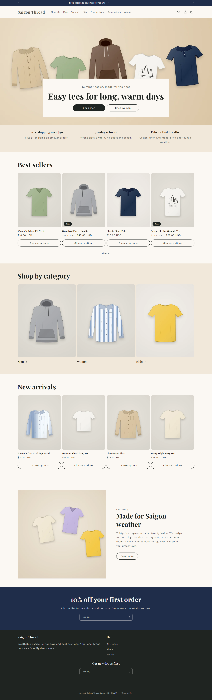
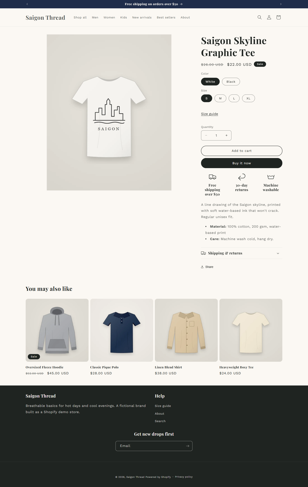
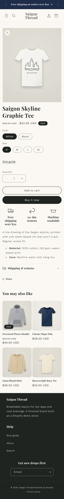

# Saigon Thread: Shopify apparel demo store

A small clothing store on Shopify, set up end to end with scripts instead of clicking through the admin.
**Saigon Thread is a fictional brand.** Products, prices and copy are made up for the demo; nothing is for sale and nothing ships.

- Live store: https://demo-proposal-store.myshopify.com (password protected; password on request)
- Theme: Shopify's [Dawn](https://github.com/Shopify/dawn) 16.2, customised through its JSON settings, not forked Liquid

| Home | Product | Mobile |
|---|---|---|
|  |  |  |

## What's in here

| Path | What it does |
|---|---|
| `data/products.json` | Catalogue: 10 products, colours x sizes (112 variants), 5 tag-based collections |
| `scripts/render-images.mjs` | Renders one flat-lay image per product colour from SVG (no stock photos, no licences) |
| `scripts/render-hero.mjs` | Builds the homepage hero and story images from the product cut-outs |
| `scripts/import.mjs` | Seeds the store through the Admin GraphQL API: staged image uploads, `productSet` upserts with per-colour variant images and stock, Online Store publishing, smart collections, pages, menus |
| `scripts/import-csv.mjs` | Imports a product CSV in Shopify's own export/import layout, with validation and `--dry-run` |
| `scripts/customize-theme.py` | Applies the brand (colours, fonts, homepage sections, product page blocks) to Dawn's JSON templates |
| `scripts/shoot.mjs` | Full-page desktop and mobile screenshots of the storefront for review |
| `theme/` | The customised Dawn theme (Dawn's licence kept in `theme/LICENSE.md`) |

Every script is safe to re-run: products, collections and pages are matched by handle and updated, not duplicated.

## Setup

1. Node 20+ and Python 3. `npm install` (Shopify CLI and Playwright are local dev dependencies).
2. In the Shopify Dev Dashboard, create an app with these Admin API scopes and install it on your store:
   `write_products, write_inventory, write_files, write_publications, write_online_store_navigation, write_content, read_locations`
3. `cp .env.example .env` and fill in `SHOP`, `CLIENT_ID`, `CLIENT_SECRET`. The scripts trade them for a short-lived
   Admin API token with the client-credentials grant, so no token is stored.
4. For image rendering and screenshots, set `CHROME_PATH` to a Chrome/Chromium binary or run `npx playwright install chromium`.

## Importing products

**From the demo catalogue** (`data/products.json`):

```sh
npm run images                 # render product images into images/
npm run import                 # products, collections, pages, menus
node --env-file=.env scripts/import.mjs --only=kids-basic-tee            # one product
node --env-file=.env scripts/import.mjs --steps=collections,menus        # selected steps
```

To add a product, add an entry to `products` in `data/products.json` (handle, title, shape, price, colours, sizes, tags),
add any new colour to `colors`, then run `npm run images` and `npm run import -- --only=<handle>`.

**From a CSV** in Shopify's product CSV format (the same file the admin exports):

```sh
npm run import:csv -- products.csv --dry-run   # check: variants, options, prices, duplicates
npm run import:csv -- products.csv             # import
```

- One row per variant; the first row of each handle carries the title, description, vendor, type, tags and option names.
- `Image Src` must be a public image URL. Images that can't be fetched are skipped and listed at the end;
  the product is still imported.
- Imported products are tagged `csv-import`, so a test batch is easy to find and remove in the admin.

## Theme

```sh
python scripts/customize-theme.py   # re-apply brand settings to theme/
npm run theme:dev                   # local preview against the store
npm run theme:push                  # upload as an unpublished theme
```

The Shopify CLI asks you to log in in the browser the first time.
